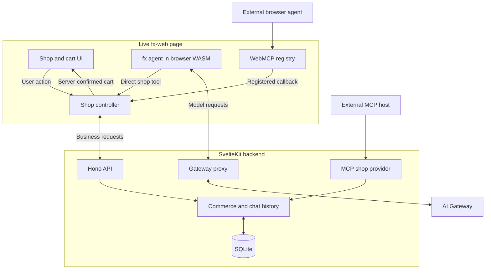

# Architecture

fx-web is one SvelteKit server that holds the shop's state. Four kinds of
actor change that state, and none of them owns it:

| Actor | Entry point | Details |
| --- | --- | --- |
| A person | The shop and cart UI | [README](../README.md#use-the-shop-and-chat) |
| The embedded `fx` agent | `shop.tools` and hosted MCP tools, called from browser WebAssembly | [Conversation persistence](chat-history.md) |
| An external browser agent | The page's WebMCP tools on `document.modelContext` | [WebMCP](webmcp.md) |
| An external MCP host | The OAuth-protected shop provider at `/mcp` | [MCP Apps](mcp-apps.md) |

The backend owns prices, stock, carts, orders, and saved chat. Every actor
reaches it through authenticated requests, so a cart change from any actor
appears for all the others. Only a person can confirm an order.

## Every browser actor shares one controller

The main page creates one `createShop()` controller. The UI buttons, the direct
`fx` tools, and the WebMCP callbacks all call it. The controller loads the cart and
catalog from `/api/cart` and `/api/catalog`. `setQuantity()` posts to
`/api/cart/quantity` and then shows the cart that the server returns. Because
of that, the page never displays a quantity the server has not confirmed.

Open tabs do not sync their cart displays with each other. Each mutation sends
the cart revision it last saw, and the server answers a stale revision with
HTTP 409 and the current cart.

## The backend checks identity on every request

People sign in at `/sign-in` with Better Auth, which manages passwords and
signed session cookies. Server page guards send guests to `/sign-in` and
signed-in visitors to the shop.

Every `/api` cart, chat, and model request also carries the user the page
expects in the `x-fx-user-id` header. The backend compares it with the user
in the session cookie before it does any work. This header cannot
authenticate anyone or choose an account. It catches a tab that still shows
the previous account after someone else signed in. On HTTP 401 the page drops
its identity, its `fx` agent, and its tools. A stale tab can't change the new
account's cart, call the model, or revoke its session.

The API accepts requests only for loopback hosts, rejects cross-origin
mutations, and limits request bodies to 64 KiB. `/api/chat` allows 6 MiB for
checkpoints.

`application-runtime.ts` runs Better Auth transactions and commerce operations
through one queue on one SQLite connection. That way an authorization check
and the write it guards run together, with no other request between them.
JWT verification and remote MCP calls run outside the queue so a slow network
call does not hold the database.

## Checkout needs a person

**Review order** creates a short-lived quote tied to the user, the session,
the cart revision, the prices, and the stock. **Confirm order** checks all of
them again. It then records one order, deducts stock, and clears the cart in a
single transaction. Repeating a completed confirmation returns the same order.

No agent tool can create a quote or confirm an order. The prototype collects
no payment, shipping, or tax.

## Model requests and business requests are separate

`fx` runs its agent loop in the browser as WebAssembly. It sends model requests
to the same-origin backend:

- `/api/generate` forwards inference to AI Gateway with the server's key.
- `/api/models` forwards model-capability lookups.
- `/api/config` reports the configured model and whether a key is set. It
  never returns the key.

`gateway-fetch.ts` routes `fx`'s Gateway calls to those two proxies and strips
the browser's placeholder authorization. `server/gateway.ts` checks the
request against the server's tool catalog. It replaces any browser-supplied
tool description or schema with the server's version.

Tool calls are business requests. They go to the cart, catalog, and MCP
routes and never pass through the model proxy. A WebMCP call from an
external agent therefore starts no `fx` turn, though that agent may use its own
model to pick the tool. The
[network demonstration](demonstrate.md#demonstrate-shared-state-and-network-boundaries)
lists each request type you can observe.

## Find the code

Paths are relative to the project directory.

| File | Owns |
| --- | --- |
| `src/routes/` | Pages, server guards, and the entries that forward `/api`, `/mcp`, and `/.well-known` to the backend |
| `src/lib/server/server-environment.ts`, `src/lib/server/env-defaults.ts` | Private configuration and its defaults, the cached runtime, and request forwarding |
| `src/lib/server/api.ts`, `src/lib/server/http.ts` | Hono routes, loopback and origin checks, body limits, and JSON validation |
| `src/lib/server/application-runtime.ts` | Better Auth, browser and OAuth identities, and the SQLite queue |
| `src/lib/server/commerce.ts` | Catalog, stock, carts, checkout, their SQL, and the shared `transaction()` |
| `src/lib/server/chat-history.ts` | Saved conversations, their revisions, and their SQL |
| `src/lib/server/gateway.ts` | Model proxies, server-approved tool definitions, and replay checks |
| `src/lib/server/mcp-provider.ts` | The `/mcp` shop provider, its UI resource, and OAuth request checks |
| `src/lib/server/mcp-metadata.ts` | Prefetch of approved OAuth client metadata outside the queue |
| `src/lib/server/mcp-client.ts` | Hosted MCP conversations, fixed tool catalogs, and view ownership |
| `src/lib/contract.ts` | Zod schemas and limits shared by the browser and the server |
| `src/lib/account.ts` | The browser's only `/api` transport, its errors, and the 401 policy |
| `src/lib/shop.ts` | The shop controller and its direct `fx` tools |
| `src/lib/webmcp.ts` | WebMCP tools and their registration |
| `src/lib/chat-controller.svelte.ts` | The `fx` engine, checkpoints, recovery, and the MCP conversation |
| `src/lib/gateway-fetch.ts` | `fx`'s Gateway calls mapped to the backend proxies |
| `src/lib/mcp-apps.ts`, `src/lib/components/McpAppCard.svelte` | The AppBridge policy and MCP App frames |
| `src/lib/components/Chat.svelte`, `Cart.svelte`, `AccountForm.svelte` | Rendering and controls |
| `src/mcp-ui/`, `vite.mcp.config.ts` | The portable shop app that `/mcp` serves |
| `scripts/mcp-sandbox.mjs`, `scripts/mcp-sandbox.html` | The cookieless sandbox proxy and its CSP |
| `scripts/*.ts` | `auth-setup`, `catalog-import`, and `database-migrate` |

## Find the tests

`task test` runs the Node tests. `task test-browser` runs the two browser
suites against a real server and Chromium. A controlled `fx` fixture replaces
the model in both, so no test calls a live model.

| Test | Proves |
| --- | --- |
| `tests/auth.test.ts` | Sign-up and sign-in, input bounds, the shared queue, loopback hosts, and body limits |
| `tests/routes.test.mjs` | Page guards, session cookies, and protocol-route rate limits |
| `tests/api.test.ts` | The model proxies, tool-definition replacement, streaming, and cancellation |
| `tests/gateway-fetch.test.ts` | `fx`'s browser transport to the model proxies |
| `tests/commerce.test.ts` | Ownership, money tampering, stock races, checkout rollback, and private database files |
| `tests/chat-history.test.ts` | Saved chat ownership, revision conflicts, lost acknowledgements, limits, and reopening SQLite |
| `tests/account.test.ts` | The browser transport, 401 handling, and aborts |
| `tests/shop.test.mjs` | The shop controller, stale responses, account changes, and a real `fx` WASM turn through the proxy |
| `tests/webmcp.test.mjs` | WebMCP registration, the shared cart, pagination, structured errors, and cancellation |
| `tests/fx-limit.test.mjs` | `fx` message and byte limits against the installed WASM package |
| `tests/mcp-provider.test.ts` | OAuth with PKCE, consent, refresh, JWT and DPoP checks, and scopes |
| `tests/mcp-host.test.ts` | Hosted catalogs, cross-account rejection, the remote server, the call and byte budgets, and the default sandbox origin |
| `tests/scripts.test.ts` | `catalog-import`, `database-migrate`, `auth-setup`, and the defaults in `.env.fx.example` |
| `tests/process.test.mjs` | Startup and cleanup of the test server fixture |
| `tests/chat.browser.mjs` | Chat, recovery, limits, accounts, and native WebMCP calls in Chromium |
| `tests/mcp-apps.browser.mjs` | Real App and AppBridge, sandbox isolation, CSP, app cart tools, and cleanup |
