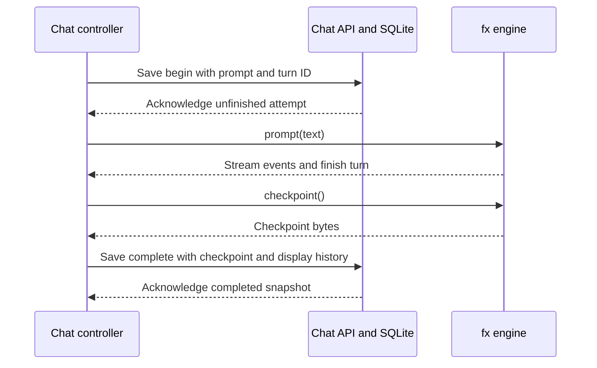

# Conversation persistence

`fx` 0.0.14 runs in the browser through `createFxEngine` from `libfx/browser`.
fx-web saves `fx` checkpoints in the backend's SQLite database itself, instead
of using `createFxAgent`'s durable sessions. It adds no OPFS, local storage,
SDK session directory, or second database.

## Storage and ownership

`chat-controller.svelte.ts` owns the browser engine, transcript, recovery, and
conversation lifecycle. `Chat.svelte` renders its state and binds the composer
and conversation elements. `/api/chat` loads or changes the signed-in user's
saved conversation. `contract.ts` defines request and response schemas
with size limits. `server/chat-history.ts` defines the table and its queries
and applies history changes.

`application-runtime.ts` creates the history store on its existing SQLite
connection after Better Auth migrations. For each `/api/chat` request,
`runtime.authorized` checks a fresh Better Auth session and a matching `x-fx-user-id`
header. The server derives ownership from that session. A client cannot choose
another owner in its request body. History persists across logout, while
revoked sessions lose access immediately.

One `chat_history` row stores the user's current conversation. Creating the
table leaves existing accounts, sessions, products, carts, and orders intact.

## Completed turns and unfinished attempts

Before enabling the composer, the browser loads saved history, creates new MCP
connections, and restores `fx` from checkpoint bytes. For each new turn, the server
records the attempt before `fx` starts and saves the result after `fx` settles:



The `complete` command commits the checkpoint, display history, and
conversation-limit status together. The same transaction clears the unfinished marker.

Here, completed means the engine has settled, including a stopped or failed
reply. It does not mean every model response succeeded. An unfinished marker
means that the server still records the attempt without a completed snapshot.
The previous completed snapshot remains separate from that attempt.

Refresh and sign-in restore completed checkpoints as data. They never call
`prompt()` or `resume()` to reconstruct history. Historical MCP App entries
show saved titles, not interactive frames. Fresh cards require a new request.
Restoring chat does not restore session-bound quotes or authorize checkout.
The current tool catalog still validates model requests. After a tool
configuration change, a saved conversation may require **New conversation**.

If an unfinished marker exists, the composer stays disabled. The user must
review the cart and explicitly discard that attempt to continue from the last
saved checkpoint, or start a new conversation. A cart action may have committed
before the interruption. Recovery neither repeats nor reverses it. Partial
streamed text is not saved and can be lost on refresh.

Restoration handles the two saved states differently:

```text
load saved conversation
	display saved messages and app titles
	create new MCP connections
	restore fx from the last completed checkpoint
	if an unfinished attempt exists
		block the composer
		require the user to review the cart and choose recovery
	otherwise
		allow the next message

never replay model calls or cart mutations to reconstruct history
```

## Failed saves and concurrent tabs

Each change carries the expected revision and a unique operation ID. SQLite
transactions serialize the revision check and update. Retrying the same last
operation with the same payload returns its existing receipt. Reusing its ID
with another payload or saving against an old revision fails with HTTP 409.
Reset advances the revision, so a late completion cannot restore cleared chat.

A failed completion save blocks sending and offers **Retry save**. The retry
sends the same checkpoint and operation ID and runs no `fx` turn. A failed
initial prompt save starts no `fx` work and requires reloading saved chat. If a
read or checkpoint restoration fails, stored data stays intact and chat stays blocked.
**New conversation** is the explicit action that clears saved history.

Revisions protect chat writes, not every cart action across browser tabs.
Stop another active tab before discarding its unfinished turn. Existing cart
revision and session checks continue to protect authoritative commerce state.

Checkpoints are limited to 4 MiB. `/api/chat` accepts up to 6 MiB for the
base64-encoded checkpoint and display history. Other API routes retain their
64 KiB request limit. Display history is limited to 128 entries and 512 KiB.

## Why one snapshot instead of a turn log

The app stores one snapshot because the UI shows one current conversation.
An immutable turn log would need archive and retention rules that nothing in
the app uses yet. An SDK execution journal could recover unfinished turns, but
it would still have to decide what to do about a cart change whose outcome is
unknown. Only the user can decide that, so the app asks them.

[Architecture](architecture.md#find-the-tests) lists the tests that cover
these rules. `task verify` runs all of them.
