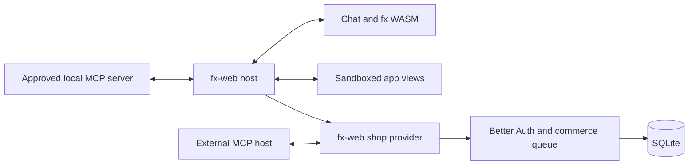
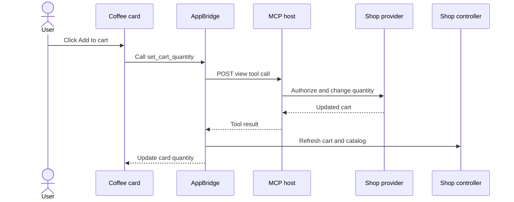

# MCP Apps

fx-web uses MCP in two directions:

- **As a host**, chat shows interactive MCP App cards and connects `fx` and those
  cards to MCP servers.
- **As a provider**, `/mcp` exposes the shop's tools and a portable shop app
  to external MCP hosts such as Codex.

The host also connects to the provider internally, as the signed-in browser
user. Both directions use the same commerce operations as the UI. See
[Architecture](architecture.md) for the shared backend.

fx-web uses ext-apps 2.0.3 and MCP SDK 2.3.1. The internal host pins protocol
revision `2026-07-28`. The provider also accepts the SDK's stateless 2025
transport, including Codex's `2025-06-18` handshake. Tests cover both
transports with the SDK's reference client. They do not check how Codex or
ChatGPT render the app.

To set up the sandbox and open a card, see
[Open an MCP App in chat](../README.md#open-an-mcp-app-in-chat).

## The host

Before it creates `fx`, `chat-controller.svelte.ts` asks the server to open an
MCP conversation. The conversation's tool catalog holds the shop's tools
under the `shop__` prefix and, if configured, a remote server's tools under
`remote__`.

For "I'd like a coffee", `fx` calls `shop__list_products` with a product query.
The result opens a Coffee card without changing the cart. Without a query,
the call opens the full shop app. The card's buttons then call MCP directly,
with no model turn:

The card sends its cart revision with the absolute quantity, and the backend
checks the revision before it writes. The button path never calls `fx` or
`/api/generate`. The page refreshes its cart after the tool result arrives.

The internal shop connection uses the browser user's session through the SDK
transport. It mints no OAuth token and skips no commerce check.

### Tool catalogs are fixed and enforced by the server

A conversation's catalog does not change after it opens. The Gateway proxy
replaces each tool definition from the browser with the server's definition.
It also checks tool names in replayed messages against the catalog. A browser
cannot redefine a tool or show an app-only tool to the model. An app can call
only the app-visible tools of the server that rendered it.

### One remote server, configured by the operator

`FX_MCP_REMOTE_URL` adds one more MCP server. It must be a fixed HTTP loopback
URL with an explicit port, such as `http://127.0.0.1:43210/mcp`, and no
credentials, query, or fragment. The transport refuses redirects.

`FX_MCP_REMOTE_TOKEN` is an optional service credential. It stays on the
server and is sent for every fx-web user, so choose a credential whose
permissions suit all of them. The browser can't set the URL or read the token.

Public HTTPS servers and remote OAuth sign-in are not supported. They would
need a network and identity policy first.

### Results and app lifecycle

The browser keeps each view's HTML and full tool result. The backend keeps
only the view ID and the connection that owns it, to authorize later app
calls. `fx` receives at most 16,000 characters of text from a result, without
resource HTML or result `_meta`. If a resource fails to render, the tool text
gets a warning and the tool does not run again.

The host initializes AppBridge, then sends the tool input and result in that
order. An app's tool calls stay bound to its view and its connection.

`ui/update-model-context` replaces a view's latest context and starts no turn.
The next user turn includes it as labeled untrusted data, up to 4,000
characters per view and 8,000 in total. `ui/message` sends through chat's
normal path and returns an error while a reply is running. There is no hidden
prompt queue and no sampling.

On account change, sign-out, reset, page exit, or unmount, the page disables
callbacks, aborts pending work, removes frames, and closes the server
conversation. Cancellation can't undo a remote mutation that already
committed. A page restored from the back-forward cache reloads, so it gets new
MCP connections.

### Conversation limits

The server keeps conversations in memory for 30 minutes, with at most four
per Better Auth session and 64 in total. Each conversation allows 32 tools,
32 calls, and 8 MiB of results. If a conversation is lost, expires, or reaches
a limit, chat blocks sending, and **New conversation** creates a replacement.

Saved chat keeps model history and tool results. After a reload, saved app
entries show their titles with no frame, HTML, or live connection. Restoring
chat never calls a tool to rebuild a card. See
[Conversation persistence](chat-history.md).

## The shop provider

External hosts connect to the application's origin followed by `/mcp`. The
provider registers its tools with the official helpers and serves the Svelte
shop app as `ui://fx-web/shop`.

| Tool | Scope | Behavior |
| --- | --- | --- |
| `list_products` | `shop:read` | Read products and prices in EUR cents |
| `get_cart` | `shop:read` | Read the user's cart and its revision |
| `set_cart_quantity` | `shop:write` | Set an absolute quantity with `expectedRevision` |

`set_cart_quantity` requires the revision from an earlier read and never
retries against a newer cart. A stale request returns the current cart. Hosts
without UI support can use each tool's text and structured result.

No tool creates a quote or confirms an order. The app links to the shop,
where a person uses **Review order** and **Confirm order**.

### Authentication

People sign in with Better Auth session cookies. External hosts use the OAuth
authorization code flow with PKCE and an explicit consent page at
`/oauth/sign-in` and `/oauth/consent`. The backend uses Better Auth's `jwt`,
`mcp`, and `cimd` plugins. The `mcp` plugin includes the OAuth provider.

Before a tool runs, the provider rejects unsigned and expired tokens and
tokens with the wrong issuer or audience. The token's user and `sid` claims
must match an existing Better Auth session. The provider does not assume that
`sub` is the Better Auth user ID, and it creates no separate agent sessions.

Inside its transaction, commerce checks the session, the token expiry, and
the operation's scope again. JWKS verification, remote MCP calls, and client
metadata fetches run outside the SQLite queue. DPoP replay reservations use
the queue.

The provider keeps the verified identity in the async request context, not on
the request object. The SDK may clone the request when it picks the stateless
transport, so the request object can't identify the user reliably.

### Token lifetime and revocation

Access tokens expire after five minutes. Ending the Better Auth session that
approved the grant blocks later shop calls. Signing out a different session
does not. Revoking refresh credentials stops renewal but does not invalidate a
JWT already issued. There is no immediate per-client revocation.

### Client registration

Unauthenticated dynamic client registration is off. The reference host
registers a public client through Better Auth's authenticated
`/api/auth/oauth2/create-client` endpoint.

Operators can approve exact HTTPS client metadata and JWKS URLs in the
`FX_MCP_CLIENT_METADATA_URLS` JSON array. The CIMD Node transport checks the
public DNS answers, pins the chosen address, and does not follow redirects.
The server fetches metadata, with a size limit, before it enters the database
queue.

Back-channel logout and sector-identifier URLs are not supported. Better Auth
registration also refuses remote JWKS URLs. An approved CIMD document can use
an approved JWKS URL. These rules keep dependency hooks from making network
requests while authentication holds the database queue.

`/mcp` and the OAuth token endpoint check their own content types. The
existing `/api` origin checks, JSON validation, and body limits still apply.

## Browser isolation

The sandbox proxy runs on the opposite loopback hostname from the shop, so
`127.0.0.1` pairs with `localhost`. A different port alone would still receive
the shop's cookies. The proxy refuses any request that carries a cookie.

Each app runs in an inner iframe with `allow-scripts` and without
`allow-same-origin`, so its origin is opaque. The parent checks the exact
proxy window and origin, and the proxy checks the exact inner window. An app
can't read its parent or a sibling app.

The response CSP blocks network connections, external scripts and styles,
forms, objects, and base URLs. It allows inline bundled code and styles, data
images, and data fonts. Resource metadata can't widen it. The iframe gets no
Gateway key, OAuth token, or session cookie. An app that needs storage,
workers, or another origin-dependent feature needs an isolation policy first.

## Sources

- [MCP Apps overview](https://modelcontextprotocol.io/extensions/apps/overview)
  and [ext-apps SDK examples](https://github.com/modelcontextprotocol/ext-apps),
  including the [Svelte server](https://github.com/modelcontextprotocol/ext-apps/tree/main/examples/basic-server-svelte)
  and the [basic host](https://github.com/modelcontextprotocol/ext-apps/blob/main/examples/basic-host/src/implementation.ts).
- [Better Auth MCP](https://better-auth.com/docs/plugins/mcp) and
  [OAuth Provider](https://better-auth.com/docs/plugins/oauth-provider) plugins.
- [MCP authorization specification](https://modelcontextprotocol.io/specification/2026-07-28/basic/authorization).
